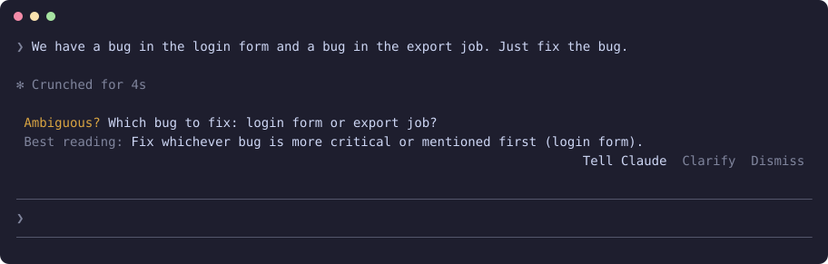

<h1 align="center">claude-ambiguous</h1>

<p align="center"><b>Catches the prompt Claude could take two ways, while you can still say which you meant.</b></p>

<p align="center">
  
  
  
  
</p>

<p align="center"></p>

<p align="center"><sub>Only this mod enabled, in a real terminal session: the prompt names two bugs and asks to fix "the bug".</sub></p>

"Just fix the bug", when there are two. A fast model reads each prompt beside the main turn and tells you what is unclear and how it would read it. Your prompt is never held up.

## Install

In a terminal, inside Claude Code:

```
/plugin install ambiguous --marketplace YlitaloJuha/claude-ambiguous
```

Or from a shell:

```bash
claude plugin install ambiguous --marketplace YlitaloJuha/claude-ambiguous
```

In the desktop app, click + next to the prompt box, then Plugins, Add marketplace with `YlitaloJuha/claude-ambiguous`, then Add plugin.

> [!NOTE]
> This repository is private for now. Installing needs read access and a GitHub credential on your machine, such as `gh auth login` then `gh auth setup-git`.

## What it does

- **Never in the way:** The check runs beside the turn. Nothing waits for it.
- **Uses the context:** A short prompt is not flagged just for being short. If the conversation settles it, nothing shows.
- **Three answers:** **Tell Claude** passes the reading to the running turn, or fills the prompt box when idle. **Clarify** starts your own sentence. **Dismiss** clears it.
- **Nothing reaches Claude unasked:** The verdict stays on your screen until you press something.

## Commands

| Command | What it does |
|---|---|
| `/ambiguous on` | Turn the check on |
| `/ambiguous off` | Turn the check off |
| `/ambiguous` | Show whether it is on |

## What it costs

One Haiku call per prompt you write. It skips slash commands, short acknowledgements, prompts over 1000 characters and anything a mod sends.

## What it can reach

No network, no shell commands and no file access through the mod API. The prompt and the end of the last reply go to Haiku through Claude Code, the same provider as your session. Run `claude plugin validate .` in this repository to list every call it makes.

## Limits

- Verdicts vary. The same prompt scored 0.95 and 0.75 in two runs, and once showed no row. Anything under 0.7 is dropped.
- Claude has already started by the time the row appears, so a late answer can land mid-work.

## Develop

```bash
claude plugin validate .
claude plugin test .
claude --plugin-dir .
```

## Credits

- The "untrusted reply" prompt pattern follows [reflect-mod](https://github.com/BayramAnnakov/claude-reflect) by Bayram Annakov (MIT).

## License and warranty

[MIT](LICENSE). `THIRD_PARTY_LICENSES.md` covers the parts that came from other projects.

Provided **as is, with no warranty of any kind**. You use it at your own risk, and the author is not liable for anything that results from using it, including lost work, usage charges or changes to your code.
